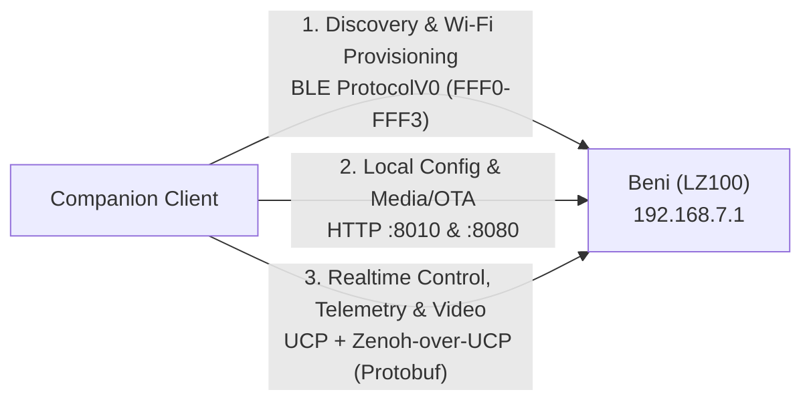

# Beni (`LZ100`) System & Protocol Architecture

This document tracks clean-room interoperability findings derived from static analysis of the companion Android app (`com.mondorobotics.mondo.app` v1.0.85) and device specifications.

## 1. Hardware Overview

- **Platform Codename:** `LZ100` (variants observed in assets: `beni`, `beni_lite`)
- **Actuation:** 7-DOF wheeled-legged robot (1.8 kg, up to 8 m/s paved, 25 cm jump, 300 g payload)
- **Cameras & Sensing:** 1/1.3" CMOS 4K60 HEVC main camera, dual front stereo obstacle-avoidance cameras (0.2–6.5 m), 3-mic array, 1 W speaker, RGBW LED eyes
- **Wireless:** Wi-Fi 6 (`802.11 a/b/g/n/ac/ax`), BLE 5.4, UWB (`IEEE 802.15.4z` for Motion Tracker)
- **Storage & Ports:** 32 GB internal + microSD (up to 1 TB, exFAT), rear USB Type-C (PD 3.0 45 W; app manifest also declares `android.hardware.usb.accessory`), top-rear Head Connection Pins, bottom charging contacts

## 2. Companion App Stack

- **UI & App Logic:** Flutter (Dart AOT in `lib/arm64-v8a/libapp.so`)
- **Custom Native Transport:** `lib/arm64-v8a/libmondo_native.so`
  - `UcpManager` — custom transport for heartbeats, DDS/data, Opus/SILK audio, and H.265 video (`H265VideoView` / `H265TextureRenderer`)
  - `NativeZenohBridge` — embeds **Eclipse Zenoh (`zenoh-pico`)** running **Zenoh-over-UCP** with Protobuf payloads (`ZP_ENCODING_APPLICATION_PROTOBUF`)
- **BLE:** `flutter_reactive_ble`

## 3. Local Communication Architecture

### 3.1 BLE Discovery & Provisioning (`ProtocolV0`)

- **UUIDs:**
  - `0000FFF0-0000-1000-8000-00805F9B34FB` (characteristics `FFF1`, `FFF2`, `FFF3`)
  - `0100FFF0-0000-1000-8000-00805F9B34FB` (characteristics `FFF1`, `FFF2`, `FFF3`)
- **Framing:** `ProtocolV0` packets with SOF header, declared length, CRC, and optional outgoing cipher for select commands. Used for initial button-press authorization, country code setup, and requesting Beni's local Wi-Fi AP credentials (6-byte MAC payload).

### 3.2 Local Wi-Fi HTTP Services (`192.168.7.1`)

- **Local Config Server (`:8010`):**
  - `http://192.168.7.1:8010/config/v1/local/version`
  - `http://192.168.7.1:8010/config/v1/local/status`
  - `http://192.168.7.1:8010/config/v1/local/query`
  - `http://192.168.7.1:8010/config/v1/local/commit`
- **Media, Files & OTA Server (`:8080`):**
  - `/media/files`, `/media/sessions`, `/media/cancel-download`
  - `/files/params_export.json`, `/files/snapshot/by_event_id/`
  - `/v2/upgrades/{uuid}/upload`, `/v2/upgrades/{uuid}/cancel-upload`
- **Local TLS Identity:** `.lz100.mondorobotics.internal` via `/cmd/security/local_tls_identity_req`

### 3.3 Zenoh-over-UCP Topics (Protobuf)

#### Command Topics (`/cmd/*`)
- **Common / System:** `ping_req/rsp`, `get_version_req/rsp`, `get_module_version_req/rsp`, `get_partition_size_req/rsp`, `get_parameter_req/rsp`, `set_parameter_req/rsp`, `get_crypto_info_req/rsp`, `accessory_list_req/rsp`, `accessory_control_req/rsp`, `robot/sn_req/rsp`, `capability/hardware_snapshot_req/rsp`, `capability/software_snapshot_req/rsp`, `parameter/query_req/rsp`, `parameter/update_req/rsp`, `time/correction_req/rsp`, `system/factory_reset_req/rsp`
- **Camera & Replay:** `camera/unified_cmd`, `camera/record_req/rsp`, `camera/capture_controls_set_req/rsp`, `camera/pre_record_get_req/rsp`, `camera/pre_record_set_req/rsp`, `camera/relative_trajectory_replay*`, `snapback/capture_control`, `storage/op_req/rsp`
- **Tracking & Missions:** `mission/request`, `mission/request_ack`, `tracking/ctrl_cmd`, `tracking/ctrl_cmd_ack`, `tracking/algo_switch_cmd`, `tracking/param_query_req/rsp`, `tracking/param_update_req/rsp`
- **RC / Motion Tracker & Games:** `rc/function_key_mode`, `rc/joystick_calib_req`, `rc/vibration_get_req/rsp`, `rc/vibration_set_req/rsp`, `game/control_req/rsp`, `game/menu_get_req/rsp`, `game/menu_set_req/rsp`, `game/player_input`
- **Audio & Mic:** `audio/op_req/rsp`, `speaker/play_cmd/rsp`, `mic/scan_req/rsp`, `mic/saved_list_req/rsp`, `mic/source_select_req/rsp`, `mic/forget_req/rsp`
- **Network, Security & OTA:** `nm/wifi_scan_req/rsp`, `nm/wifi_connect_req/rsp`, `nm/wifi_provision_*`, `vt/set_mode_req/rsp`, `vt/disconn_req/rsp`, `security/core_board_sn_req/rsp`, `security/device_attest_req/rsp`, `security/device_activate_req/rsp`, `security/local_tls_identity_req/rsp`, `ota/upgrade_control_req/rsp`

#### Status Topics (`/status/*`)
- `/status/robot/status`, `/status/pmu/osd_status`, `/status/scheduler/status`
- `/status/camera/status`, `/status/camera/capture_controls`, `/status/camera/relative_trajectory_replay_status`, `/status/storage/status`, `/status/media/catalog_changed`
- `/status/tracking/status`, `/status/snapback/ready`
- `/status/rc/fsm_state`, `/status/rc/joystick_raw`, `/status/rc/joystick_calib_progress`, `/status/uwb/rc_status_list`
- `/status/hms/active_snapshot`, `/status/hms/event_broadcast`, `/status/hms/query_active`
- `/status/audio/status`, `/status/mic/status`, `/status/mic/scan_result`, `/status/mic/saved_list`
- `/status/game/status`, `/status/game/tug_status`, `/status/ota/upgrade_progress`

## 4. Firmware OTA Architecture

- **Cloud API (`https://global-api.mondorobotics.com`, authenticated):**
  - `/app/v1/files/package/latest` and `/app/v1/files/package/list`
  - `/app/v1/files/getDownloadUrl` → returns presigned Alibaba Cloud OSS URL
  - `/app/v1/user-device/{sn}/security/ota-key-envelope` (+ `/challenge`)
- **Robot Installation:** Uploaded via `http://192.168.7.1:8080/v2/upgrades/{uuid}/upload` and orchestrated via `/cmd/ota/upgrade_control_req` & `/status/ota/upgrade_progress`. On-device staging, integrity verification, and key-envelope handling indicate cryptographic firmware verification.
